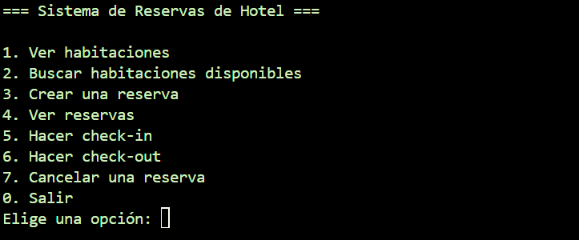
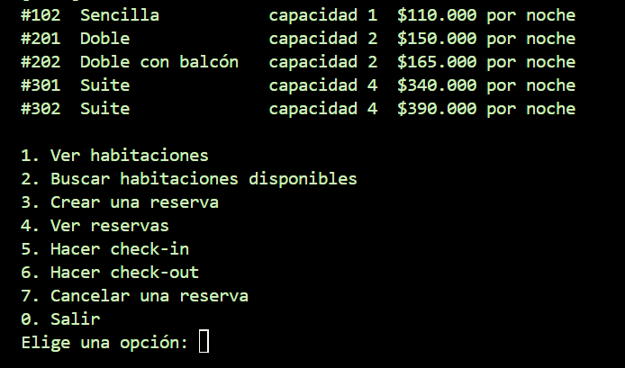
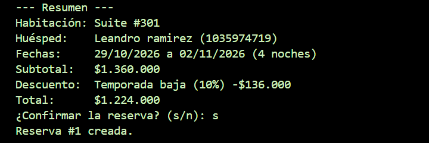
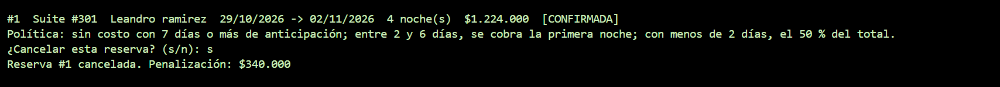
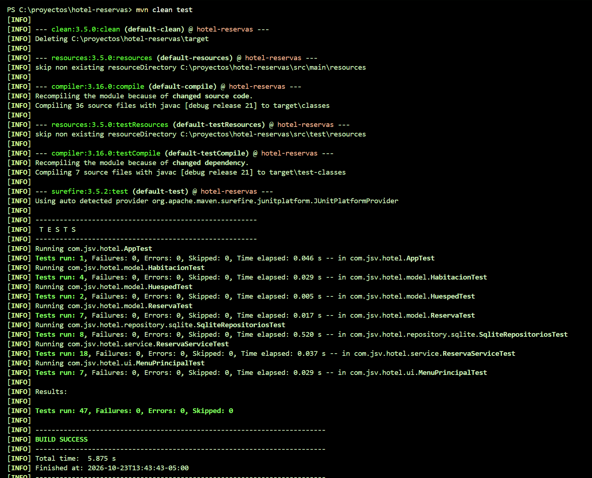

# Sistema de Reservas de Hotel


Aplicación de consola en Java para gestionar las reservas de un hotel: habitaciones de distintos tipos, huéspedes, disponibilidad por fechas, descuentos, cancelaciones con penalización y check-in/check-out. Los datos se guardan en una base de datos SQLite.

Proyecto personal para practicar programación orientada a objetos, arquitectura por capas, acceso a datos con JDBC y pruebas automáticas.

## Capturas

| Menú principal | Habitaciones |
|---|---|
|  |  |

| Resumen de una reserva con descuento | Cancelación con penalización |
|---|---|
|  |  |



## Funcionalidades

- Tres tipos de habitación (sencilla, doble y suite), cada una con su capacidad y su forma de calcular el precio por noche
- Búsqueda de habitaciones disponibles por fechas y número de huéspedes
- Creación de reservas con cotización previa y confirmación
- Cancelación con política de penalización
- Check-in y check-out con control de estados
- Persistencia en SQLite: los datos se conservan entre ejecuciones
- Menú interactivo con validación de datos y mensajes de error claros

## Reglas de negocio

| Regla | Detalle |
|---|---|
| Disponibilidad | Una habitación no se puede reservar si sus fechas se solapan con otra reserva activa. Se puede entrar el mismo día en que otro huésped sale. |
| Precio por noche | Sencilla: precio base. Doble: precio base, con recargo del 10 % si tiene balcón. Suite: precio base más desayuno. |
| Descuento por estancia larga | 10 % desde 7 noches y 15 % desde 14 noches. |
| Descuento de temporada baja | 10 % si la entrada es en febrero, marzo, septiembre u octubre. |
| Acumulación | Se aplica el mayor descuento; no se suman. |
| Cancelación | 7 días o más de anticipación: sin costo. Entre 2 y 6 días: valor de la primera noche. Menos de 2 días: 50 % del total. La penalización nunca supera el total. |
| Check-in | Solo desde la fecha de entrada. |
| Estados de la reserva | Confirmada, en curso, finalizada y cancelada, con transiciones controladas. |

## Arquitectura

El proyecto está organizado en capas, y cada una depende solo de la inferior:

```
Interfaz de consola  (ui)
        │
Servicio de reservas (service)  ── descuentos y cancelaciones (pricing)
        │
Repositorios (interfaces)
   ├── En memoria  (usados en las pruebas)
   └── SQLite con JDBC
        │
Modelo de dominio (model)
```

Decisiones de diseño:

- **Polimorfismo:** `Habitacion` es una clase abstracta y cada tipo calcula su precio, sin condicionales por tipo.
- **Patrón Strategy** en los descuentos: agregar uno nuevo no obliga a modificar la calculadora.
- **Patrón Repositorio:** el servicio solo conoce interfaces, por lo que cambiar de memoria a SQLite no modificó ninguna regla de negocio.
- **Dinero con `BigDecimal`**, nunca con `double`.
- **Reloj inyectable (`Clock`):** las pruebas de fechas no dependen del día en que se ejecutan.
- **Excepciones propias** para las reglas de negocio, separadas de los errores técnicos de la base de datos.
- **`PreparedStatement`** en todas las consultas, con claves foráneas y restricciones en el esquema.

## Tecnologías

- Java 21 y Maven
- SQLite con JDBC
- JUnit 5
- GitHub Actions (integración continua)

## Estructura del proyecto

```
src/
├── main/java/com/jsv/hotel/
│   ├── App.java            # Punto de entrada
│   ├── exception/          # Excepciones del negocio y de persistencia
│   ├── model/              # Habitaciones, huéspedes y reservas
│   ├── pricing/            # Descuentos y política de cancelación
│   ├── repository/         # Interfaces, versión en memoria y versión SQLite
│   ├── service/            # Reglas de negocio
│   └── ui/                 # Menú de consola
└── test/java/com/jsv/hotel/  # Pruebas
```

## Cómo ejecutarlo

Requisitos: Java 21 o superior, Maven y Git.

```bash
git clone https://github.com/JSV-AFK/hotel-reservas.git
cd hotel-reservas
mvn -q compile exec:java
```

La primera vez se crea el archivo `hotel.db` con 6 habitaciones. Para empezar de cero, borra ese archivo.

## Pruebas

```bash
mvn clean test
```

Son 47 pruebas automáticas que cubren el modelo, las reglas de negocio (disponibilidad, descuentos y cancelaciones), la persistencia en SQLite y la interfaz de consola, simulando a un usuario que escribe en el teclado.

## Limitaciones conocidas y próximos pasos

- Guardar al huésped y la reserva son dos operaciones separadas: falta envolverlas en una transacción.
- Si un huésped ya existe con ese documento, se reutiliza su registro sin actualizar sus datos.
- API REST con Spring Boot sobre el mismo servicio
- Contenerización con Docker
- Gestión de pagos y de usuarios del hotel

## Autor

**Juan Sebastián Vélez Correa**

GitHub: [JSV-AFK](https://github.com/JSV-AFK)
